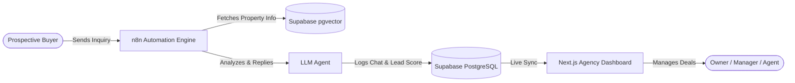
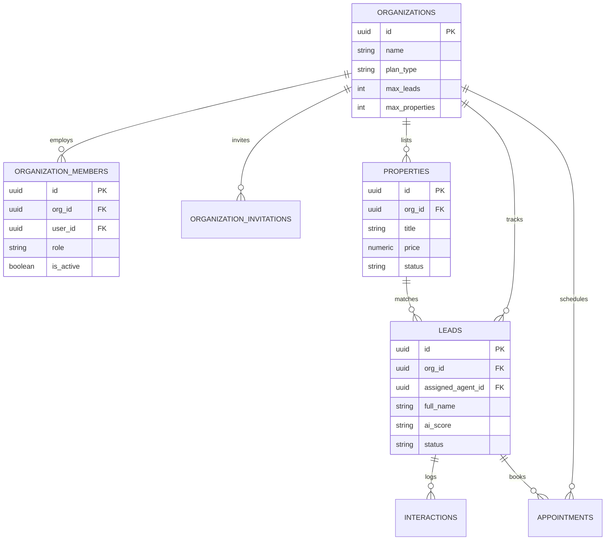

# Real Estate AI Lead Management SaaS — System Architecture

> **Note:** This repository documents the system architecture, database design, and AI automation workflows behind a production-ready Multi-Tenant Real Estate SaaS. To protect commercial intellectual property, the core application source code and raw automation workflows remain in a private repository.

---

## Overview

Real estate agencies often lose potential buyers due to slow response times and disorganized follow-ups. This platform solves that problem by combining a modern agency dashboard with an automated AI assistant.

When a prospective buyer reaches out, the AI instantly answers property questions, sends brochures, scores the lead's intent, books site visits, and routes the conversation to the right sales agent—all in real time.

---

## Tech Stack

- **Frontend:** Next.js (App Router), Tailwind CSS, DaisyUI
- **Backend & Database:** Supabase (PostgreSQL, Auth, Storage, Realtime)
- **AI & Automation:** n8n Workflows, Gemini / OpenAI API, pgvector (RAG)
- **Billing:** Stripe Subscriptions

---

## How the System Works (End-to-End Flow)

1. **Instant Capture:** A buyer sends a message through web chat or WhatsApp, triggering an n8n webhook.
2. **Context Retrieval (RAG):** The workflow searches property listings and brochures stored in Supabase (`pgvector`) to pull accurate details.
3. **Smart Qualification:** The AI replies naturally, answers pricing or location questions, and categorizes the buyer as **Hot**, **Warm**, or **Cold**.
4. **Live Dashboard Sync:** The lead and conversation history appear immediately on the agency's Next.js dashboard, automatically assigned to an available agent.

---

## Multi-Tenant Database Design

The database is built to securely host multiple real estate agencies on a single infrastructure while keeping every agency's data completely isolated.

### Key Architectural Decisions

- **Strict Data Isolation (RLS):** Every table is protected by PostgreSQL Row Level Security. Users can only query or modify records belonging to their own agency.
- **Role-Based Access Control (RBAC):**
  - **Owners:** Full control over agency settings, billing, team roles, and data exports.
  - **Managers:** Can invite agents, manage property listings, assign leads, and view audit logs.
  - **Agents:** Focused workspace to handle assigned leads, chat with buyers, and manage site visits without accidental deletion rights.
- **Automated Team Onboarding:** A custom PostgreSQL trigger intercepts new user signups. If a pending team invitation exists for that email, the user is automatically placed into the inviting agency with their assigned role; otherwise, a new agency workspace is provisioned for them.
- **Database-Level Plan Enforcement:** Subscription limits (such as maximum leads or active properties on the Free tier) are enforced directly via database triggers before insertion, preventing API bypasses.
- **Safe Data Retention:** Foreign keys use `ON DELETE SET NULL` for agents and properties so historical customer leads and chat logs remain intact even if a listing is removed or a team member leaves.

---

## Security & Audit Practices

- **Data Transfer Auditing:** All CSV lead and property imports/exports are logged with user IDs and timestamps, visible only to Owners and Managers.
- **Zero-Secret Exposure:** Environment variables and service role keys are strictly isolated within server-side functions and encrypted n8n credentials.

---

## Visual Preview

_(Add screenshots or short GIFs of your Next.js dashboard and n8n workflow canvas here once the UI is ready)_

- `assets/dashboard-overview.png` — Real-time lead pipeline and AI scoring view
- `assets/n8n-workflow.png` — Automated lead qualification and follow-up pipeline
