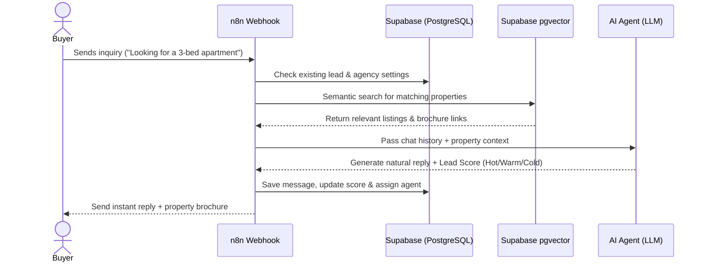
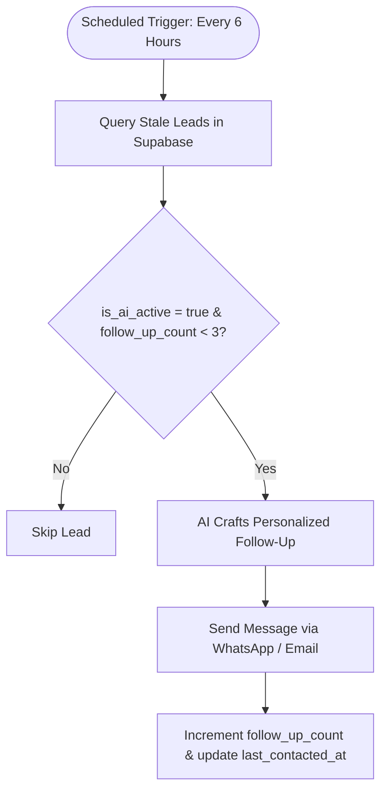

# AI & Automation Architecture (n8n + RAG)

This document outlines how customer inquiries are processed, qualified, and routed in real time using n8n workflows, Supabase Vector (`pgvector`), and Large Language Models.

---

## 1. Real-Time Lead Capture & AI Reply Flow

When a buyer sends a message via WhatsApp or the web widget, the automation pipeline handles the entire initial conversation without human delay.

### Key Workflow Steps
* **Agency Validation:** Before triggering AI responses, the workflow checks `can_use_ai` and `subscription_status` in the `organizations` table to ensure active plan permissions.
* **Context-Aware Answers (RAG):** Instead of guessing property prices or availability, the AI queries embeddings stored in `pgvector` so every answer is grounded in the agency's actual listings.
* **Human Handoff Control:** Each lead has an `is_ai_active` flag. If a human agent jumps into the chat from the Next.js dashboard, the AI automatically pauses for that conversation.

---

## 2. Automated Follow-Up Pipeline (Stale Lead Recovery)

Leads often go quiet after an initial inquiry. A scheduled background workflow ensures no potential buyer slips through the cracks.

### Safeguards Built Into the Workflow
* **Spam Prevention:** The workflow tracks `follow_up_count` and `last_contacted_at` directly in the database, stopping automated nudges after a set limit or once a deal is marked `closed` or `lost`.
* **Smart Agent Routing:** When a new lead is scored as **Hot**, the workflow checks `auto_assign_leads` and assigns the lead only to team members where `is_active = true` (skipping agents on leave).
