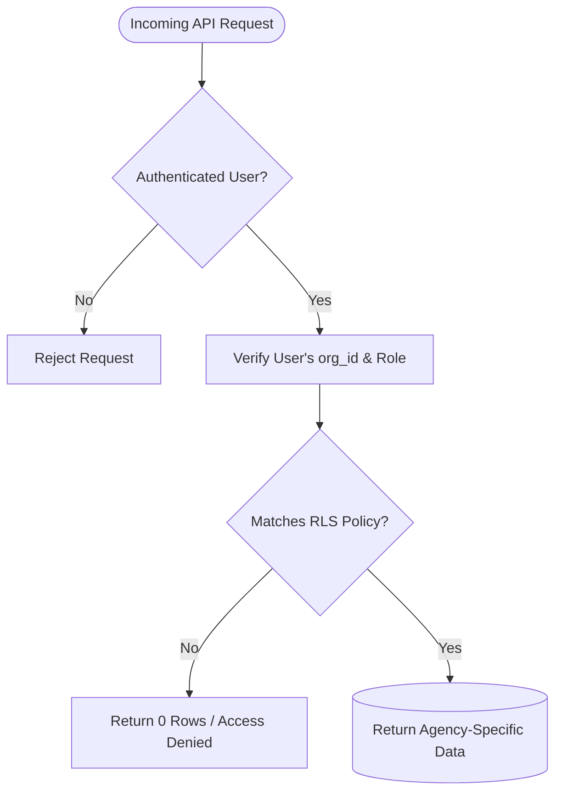

# Security Architecture & Role-Based Access Control (RBAC)

Because this SaaS handles sensitive client leads and property data for multiple real estate agencies on a shared database, strict tenant isolation and permission boundaries are enforced at the database layer.

---

## 1. Multi-Tenant Data Isolation (Row Level Security)

Rather than relying solely on frontend checks or API filters, every table (`organizations`, `properties`, `leads`, `interactions`, `appointments`) enforces **PostgreSQL Row Level Security (RLS)**.

- **Zero Cross-Tenant Leaks:** Even if a user attempts to query another agency's record ID directly via the API, PostgreSQL blocks the operation automatically.

---

## 2. Role Hierarchy & Permissions

Each agency manages its own team under three distinct roles stored in `organization_members`:

| Capability                          |      Owner       |     Manager      |        Agent         |
| :---------------------------------- | :--------------: | :--------------: | :------------------: |
| Update Agency Profile & Billing     |       Yes        |        No        |          No          |
| Invite & Manage Team Members        |       Yes        |       Yes        |          No          |
| Create / Edit Property Listings     |       Yes        |       Yes        |      View Only       |
| View & Update Customer Leads        | All Agency Leads | All Agency Leads | Assigned / Org Leads |
| Delete Customer Leads               |       Yes        |       Yes        |          No          |
| View CSV Import / Export Audit Logs |       Yes        |       Yes        |          No          |

---

## 3. Audit Logging & Data Protection

- **CSV Transfer Tracking:** Every bulk import or export of leads or properties writes an immutable entry to `data_transfer_logs` capturing the `user_id`, `action_type`, `record_count`, and timestamp.
- **Safe Deletion Rules:** Deleting a property or removing an agent sets the foreign key reference to `NULL` rather than cascading deletes to historical customer leads, preserving agency revenue analytics.
